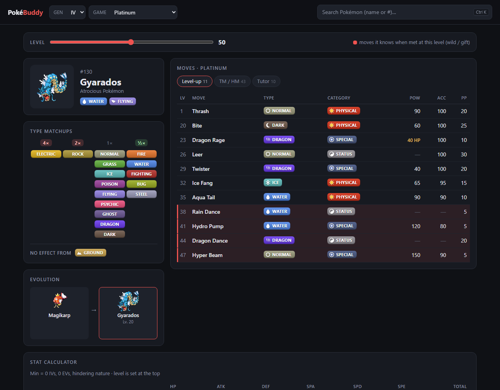

# PokéBuddy

A fast, dark-mode Pokémon companion for **Generation III to VI** games. Pick your game,
search a Pokémon, and see everything you need at a glance: types, type matchups,
evolutions, moves with level-based move prediction, and a stat calculator. Every value
shows the data for the game you picked, not today's values.



> [!IMPORTANT]
> ### Powered by PokéAPI. Thank you! ♥
>
> All Pokémon data in this app comes from **[PokéAPI](https://pokeapi.co)**, a free
> and open RESTful Pokémon API built and maintained by volunteers. Sprites come from
> their companion repository [PokeAPI/sprites](https://github.com/PokeAPI/sprites).
> Without their huge effort this project could not exist.
>
> If you find this app useful, please consider
> [supporting PokéAPI](https://pokeapi.co/about) or
> [contributing to it on GitHub](https://github.com/PokeAPI/pokeapi).
>
> To be a good citizen of a free API, this app caches every response in your browser
> and never asks for the same resource twice (see [Caching](#caching)).

---

## Features

- **Gen III–VI, game by game**. Your choice is remembered between visits.

  | Gen | Games |
  | --- | ----- |
  | III | Ruby/Sapphire, Emerald, FireRed/LeafGreen |
  | IV  | Diamond/Pearl, Platinum, HeartGold/SoulSilver |
  | V   | Black/White, Black 2/White 2 |
  | VI  | X/Y, Omega Ruby/Alpha Sapphire |
- **Search** by English name or Pokédex number. Press <kbd>Ctrl</kbd>/<kbd>⌘</kbd> + <kbd>K</kbd> or <kbd>/</kbd>
  from anywhere to jump to it.
- **Types and type matchups**: a damage table (4× … 0×) built from that generation's
  type chart, e.g. Steel still resists Ghost and Dark before Gen VI, and Fairy only
  shows up from Gen VI on.
- **Alternate forms**: Mega Evolutions, Rotom's appliance forms, Deoxys' Formes,
  Castform's weather forms and more, each with its own types, matchups, stats and
  moves. A form is only offered in games where it exists (e.g. Megas from X/Y on,
  Rotom forms from Platinum on), and its typing follows that game (appliance Rotom are
  still Electric/Ghost in Platinum).
- **Evolution chain** with the requirement for every step in the selected game, e.g.
  Leafeon evolves at Eterna Forest in Platinum and Pinwheel Forest in Black/White.
  Clicking a stage opens that Pokémon.
- **Moves** by level-up, TM/HM (HMs first, numbered as in the game), egg and tutor, with type, physical/special/status
  category, power, accuracy and PP as they were in that game. In Gen III, a damaging
  move is physical or special depending on its type, as it was before the Gen IV split.
  - Moves without a fixed power show what they actually do: `40 HP` for Dragon Rage,
    `= Lv` for Seismic Toss, `1–150` for Gyro Ball, `OHKO` for Fissure, and so on.
  - Click any move for a details dialog: the in-game description, effect, priority,
    target and effect chance.
- **Move prediction**: set a level and the app highlights the four moves the Pokémon
  knows when you meet it at that level (wild or gift). The games work this out by walking the
  level-up learnset in order and keeping the last four moves, and the app does the same.
- **Stat calculator**: the minimum stats at the chosen level (0 IVs, 0 EVs,
  hindering nature) next to the base stats.
- **Shareable URLs**: the address bar holds generation, game, Pokémon and form
  (`#4/platinum/gyarados`, `#6/x-y/charizard/charizard-mega-x`), so you can bookmark
  or share any page.

## Using it

Open the hosted version on GitHub Pages, or run it locally (see below).

1. Pick a **Gen** and **Game** in the header.
2. Search for a Pokémon by name or number and press <kbd>Enter</kbd>.
3. Drag the **Level** slider to see the predicted moveset and minimum stats.
4. Click a move for details, or an evolution to jump to that Pokémon.

## Getting started

### Requirements

- [Node.js](https://nodejs.org) **20.19+ or 22.12+** (see [`.nvmrc`](.nvmrc); with
  nvm just run `nvm use`)
- npm (comes with Node)

### Run locally

```bash
npm install
npm run dev
```

Then open <http://localhost:5173>.

### Scripts

| Command             | What it does                                         |
| ------------------- | ---------------------------------------------------- |
| `npm run dev`       | Start the Vite dev server with hot reload            |
| `npm run build`     | Type-check and build the static site into `dist/`    |
| `npm run preview`   | Serve the production build locally                   |
| `npm run typecheck` | Run the TypeScript compiler without emitting files   |
| `npm run generate:machines` | Regenerate the TM/HM table in `src/data/machines.json` |

## Tech stack

- [React 19](https://react.dev) and [TypeScript](https://www.typescriptlang.org)
- [Vite](https://vite.dev) for dev server and builds
- [Tailwind CSS v4](https://tailwindcss.com) for styling
- [PokéAPI](https://pokeapi.co) for data, called directly from the browser

It's frontend only. There is no backend, database or API key. The build is a folder of static
files that can be hosted anywhere.

## Project structure

```
src/
├── main.tsx              # React entry point
├── App.tsx               # Layout, routing, species list
├── index.css             # Tailwind import and theme colours
├── data/
│   └── machines.json     # Generated TM/HM numbers per game (see scripts/)
├── lib/
│   ├── api.ts            # PokéAPI fetching with memory + Cache Storage caching
│   ├── constants.ts      # Games, type colours, special move-power labels
│   ├── hooks.ts          # useAsync
│   ├── route.ts          # Hash routing, saved gen/game
│   ├── types.ts          # Shared app types (Version, SpeciesEntry)
│   ├── pokeapi-types.ts  # Types for the PokéAPI responses we read
│   └── pokemon.ts        # Generation-correct logic: types, stats, moves,
│                         # matchups, evolutions, move prediction, stat formula
└── components/           # Header, SearchBox, PokemonView, TypeMatchups,
                          # Evolution, Moves, MoveDialog, LevelControl,
                          # StatCalculator, Badges (type/category icons), Card
scripts/
└── generate-machines.ts  # Builds src/data/machines.json from PokéAPI
```

## How it works

### Generation-correct data

PokéAPI returns current data, plus history fields that record older values. The app
uses them to show each value as it was in the selected game:

| Data             | PokéAPI field                               |
| ---------------- | ------------------------------------------- |
| Pokémon types    | `past_types` (e.g. Clefairy was Normal)     |
| Base stats       | `past_stats`                                |
| Type chart       | `past_damage_relations`                     |
| Move power/acc/PP| `past_values` (e.g. Tackle was 35 / 95%)    |
| Evolution method | `evolution_details[].version_group`         |
| Learnsets        | `version_group_details`, including `order`  |
| Form availability| `pokemon-form.version_group` (the game a form was introduced in) |
| Move category    | `damage_class`, or the move's type in Gen III |

Moves learned at the same level are kept in the game's learnset `order`. This order
matters for the move prediction.

### Caching

PokéAPI is free and run by volunteers, and data for these games never changes. So every response is
cached twice:

1. **In memory** for the current page, so concurrent requests are shared.
2. **In [Cache Storage](https://developer.mozilla.org/docs/Web/API/CacheStorage)**,
   so the data survives reloads. A Pokémon you've already viewed loads without any
   network request.

To discard the cache (e.g. after changing what's fetched), bump `CACHE_NAME` in
[`src/lib/api.ts`](src/lib/api.ts). Cache Storage needs a secure context, so it works on
`https://` and `localhost`. Elsewhere the app silently falls back to the network.

### TM/HM numbers

PokéAPI keeps a move's TM/HM number in a separate `machine` resource for each game, so
looking them up at runtime would cost one extra request per move. Instead,
[`scripts/generate-machines.ts`](scripts/generate-machines.ts) fetches them all once with a
single query to PokéAPI's GraphQL API. It writes them to
[`src/data/machines.json`](src/data/machines.json), which is committed and bundled with the app
(about 2 KB gzipped). Re-run `npm run generate:machines` after adding a game to `GENS`.

## Deployment (GitHub Pages)

The workflow in [`.github/workflows/deploy.yml`](.github/workflows/deploy.yml) builds the
site and publishes it to GitHub Pages:

- **Push to `main`**: type-check, build, deploy.
- **Pull request**: type-check and build only, nothing gets deployed.
- **Manual**: run it from the *Actions* tab ("Run workflow").

One-time setup in your fork:

1. Push the repository to GitHub.
2. Go to **Settings → Pages → Build and deployment** and set **Source** to
   **GitHub Actions**.
3. Push to `main` (or run the workflow manually). The site appears at
   `https://<your-user>.github.io/<repo-name>/`.

No configuration needed for the repository name: the build uses relative asset paths
and hash-based routing, so it works from any sub-path.

## Contributing

Issues and pull requests are welcome. Ideas that fit the project:

- Support for more generations (see `GENS` in [`src/lib/constants.ts`](src/lib/constants.ts)).
  Gen VII needs regional-form evolutions and evolution moves, Gen I–II need their own
  stat formula, and Gen VIII+ needs per-game Pokédexes.
- Abilities, held items, encounter locations

Please run `npm run build` before opening a PR. CI runs the same check.

## Disclaimer

**This is an unofficial, non-commercial fan project.** It is **not affiliated with,
endorsed, sponsored or approved by Nintendo, The Pokémon Company, Game Freak,
Creatures Inc. or Niantic.**

Pokémon and all Pokémon character names, images and related marks are trademarks
and © of their respective owners (© Nintendo / Creatures Inc. / GAME FREAK inc.).
All game data and sprites are provided by [PokéAPI](https://pokeapi.co). No copyright
or trademark infringement is intended. The type and move-category icons in this app are
original drawings in the spirit of the games, not copies of official artwork.

## License

The source code of this project is released under the [MIT License](LICENSE),
© 2026 Johann Lochbaum.

The license covers this project's own code only. Pokémon data and sprites belong to
their respective owners and are served by PokéAPI (see [Disclaimer](#disclaimer)).

## Acknowledgements

- **[PokéAPI](https://pokeapi.co)** and its contributors, for the data, and
  [PokeAPI/sprites](https://github.com/PokeAPI/sprites) for the sprites. Thank you!
- [Bulbapedia](https://bulbapedia.bulbagarden.net) for documenting game mechanics such
  as how wild Pokémon movesets are generated.
